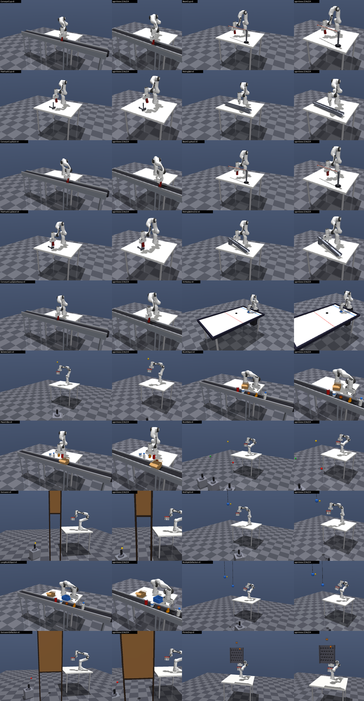

# dynamic-environments

MuJoCo reproductions of **all simulation scenarios** from *Intercepting the Future: Latent-Space
Predictive World Model for Dynamic VLA Manipulation* (Syed, Jakobsson, Hao, Ichnowski — CoRL 2026,
arXiv:2606.02486), Appendix C.1. This repo covers simulation only. It does not include the VLA, the
world model, or the baselines.

The setup follows the paper: MuJoCo, a Franka Emika Panda with a parallel-jaw gripper, a fixed
third-person RGB camera rendered at 224×224, control at 30 Hz, and per-episode randomization of object
positions, motion parameters, lighting direction and camera pose.



## Coverage: 20 scenario configurations (19 distinct scenes + the speed sweep)

| # | Paper scenario | Env id | Paper ref | Randomized per episode | Success (App. C.4) |
|---|---|---|---|---|---|
| 1 | Conveyor + cup | `ConveyorCup-v0` | Fig 4a, Tab 1 | belt speed 5–25 cm/s, spawn pos, belt height, direction | grasp with both fingers, lift ≥10 cm, hold 3 s |
| 2 | Beam + cup | `BeamCup-v0` | Fig 4b, Tab 1 | speed 5–20 cm/s, beam yaw & position, start | 〃 |
| 3 | Pole push + cup | `PolePushCup-v0` | Fig 4c, Tab 1 | speed 8–22 cm/s, push direction, start offset | 〃 |
| 4 | Rolling ball | `RollingBall-v0` | Fig 4d, Tab 1 | speed 10–30 cm/s, track yaw/position, direction | ball speed <10% of pre-contact speed within 500 ms of first contact |
| 5 | Conveyor (accel/decel) | `ConveyorCupAccel-v0` | Tab 1 | linearly increasing *or* decreasing belt speed | as #1 |
| 6 | Beam (accel/decel) | `BeamCupAccel-v0` | Tab 1 | linearly increasing *or* decreasing speed | as #1 |
| 7 | Pole push (decel) | `PolePushCupDecel-v0` | Tab 1 | frictional (constant) deceleration to rest | as #1 |
| 8 | Rolling ball (gravity) | `RollingBallIncline-v0` | Tab 1 | incline slope 5–15° | as #4 |
| 9 | Speed sweep | `ConveyorCupSpeedSweep-v0` | Tab 2 | pass `speed=0.0 … 0.40` (m/s) | as #1 |
| 10 | Air Hockey (AH) | `AirHockey-v0` | Fig 5a, Tab 3 | puck start, speed 0.5–1.2 m/s, direction, bank shots | puck deflected back ≥30 cm after paddle contact |
| 11 | Ballistic Catch (BC) | `BallisticCatch-v0` | Fig 5b, Tab 3 | launcher pose, launch time, parabola | ball in net when its vertical velocity first turns positive |
| 12 | Multi-Object (MO) | `MultiObject-v0` | Fig 5d, Tab 3 | 3–5 objects, identities, spacing, speed; target | as #1 on the *named* object; grasping another = fail |
| 13 | Place in Box (PiB) | `PlaceInBox-v0` | Fig 5c, Tab 3 | box speed 10–20 cm/s, 3–5 table objects, target | object inside box when box leaves workspace, no table contact after pick-up |
| 14 | Multi-Balls (MB) | `MultiBalls-v0` | Fig 5e, Tab 3 | 3 launchers/balls (green, red, yellow), target colour | as #11 for the named ball; catching another = fail |
| 15 | Occlusion (Occ) | `Occlusion-v0` | Fig 5f, Tab 3 | occluded interval 300–600 ms, launch | as #11, catch after reappearance |
| 16 | Mid-flight Δ (Mid) | `MidFlight-v0` | Fig 5g, Tab 3 | deflector contact geometry, launch | as #11, catch after the deflection |
| 17 | Language + Multi-Obj (L+MO) | `LangMultiObject-v0` | Fig 5h, Tab 3 | 3–5 moving objects, blue/brown box placement, target object & box | named object resting in the named box |
| 18 | Multiple deflection | `MultipleDeflection-v0` | Fig 6a, Tab 9 | 2 deflectors, launch; `window_ms` | gripper/net touches ball within the time-to-exit window |
| 19 | Occlusion deflection | `OcclusionDeflection-v0` | Fig 6b, Tab 10 | deflection hidden behind occluder; `window_ms` | 〃 |
| 20 | Plinko drop | `PlinkoDrop-v0` | Fig 6c, Tab 11 | release offset/velocity, board position; `window_ms` | 〃 |

Every scenario also randomizes the sun direction and intensity, light intensities, and the camera pose (±3 cm
look-at, ±4° azimuth, ±3° elevation, ±5% distance).

### Extension (not in the paper): `ConveyorCupGoal-v0`

Pick the moving cup off the conveyor, then carry it to a random goal position and hold it there.

* **Goal**: the cup's base position, sampled per episode from x 0.30–0.55, y −0.30–0.30, and 5–30 cm
  above the table. It is not rendered; read it from `info["goal"]`.
* **Success**: the cup is held within 2 cm of the goal (`goal_tolerance`). The env does **not**
  terminate on success: it keeps simulating, with the robot holding the cup, so every episode is
  exactly `episode_seconds × 30` = 150 frames.
* **Step indices**: `info["grasp_step"]` and `info["reached_step"]` are the first frames showing the
  grasp and the goal reach. Over 48 expert episodes, grasp happened at frames 33–63 and the reach at
  frames 62–122.
* **Data**: `scripts/collect_demos.py ConveyorCupGoal-v0` also saves `goal`, `grasp_step` and
  `reached_step` in each episode file.

## Setup

```bash
python3 -m venv .venv
.venv/bin/pip install -e .          # mujoco, numpy, gymnasium, imageio, pillow
export MUJOCO_GL=egl                # headless rendering (use "glfw" with a display)
```

All assets are already in `assets/`, so there is nothing to download.

## Usage

```python
import dynamic_envs                      # also registers the gymnasium ids "DynamicEnvs/<name>"

env = dynamic_envs.make("ConveyorCup-v0")            # or gymnasium.make("DynamicEnvs/ConveyorCup-v0")
obs, info = env.reset(seed=0)
info["instruction"]                                   # 'pick up the red cup'
obs, reward, terminated, truncated, info = env.step(env.action_space.sample())
obs["image"]                                          # (224, 224, 3) uint8, fixed third-person camera
obs["state"]                                          # (15,) TCP pos(3) + quat(4), gripper width, 7 joint angles

# Scenario parameters are keyword arguments (each task has a Config dataclass):
dynamic_envs.make("ConveyorCupSpeedSweep-v0", speed=0.40)     # Table 2 sweep point
dynamic_envs.make("PlinkoDrop-v0", window_ms=1600)            # Tables 9-11 reaction window
dynamic_envs.make("BeamCup-v0", profile="accel", speed_range=(0.05, 0.10))
```

**Interface**

* **Control**: 30 Hz, with 16 physics substeps of 1/480 s each (implicit-fast integrator, elliptic cones).
* **Actions** (`action_mode=`):
  * `"ee_delta"` (default, OpenVLA-style): 7-D `[dx, dy, dz, droll, dpitch, dyaw, grip]` in [-1, 1],
    scaled to 3 cm and 0.15 rad per step. Grip is -1 open, +1 closed.
  * `"ee_abs"`: `[x, y, z, qw, qx, qy, qz, grip]` in the world frame.
  * `"joint"`: 7 joint targets + grip.

  End-effector targets go through damped-least-squares IK with a nullspace posture term. Joint motion is
  limited by the Franka joint-velocity limits and tracked by the Menagerie position servos, with
  gravity compensation.
* **Tools**: the catching tasks mount an octagonal net beside the gripper (Figs. 5–6), and Air Hockey
  clamps a mallet in the fingers. In both cases the control point is the tool (`net_center` /
  `mallet_center`).
* **Episode end**: `terminated` on success or on a task failure (ball hits the floor, object leaves the
  workspace, wrong object grasped, …). `truncated` at the time limit. The reward is a sparse 1.0 on
  success. `info` has `success`, `failure`, `time`, `family`, `instruction`, plus task fields such as
  `occluded_interval`, `deflect_time`, `window_ms` and `release_time`.
* **Determinism**: the same seed gives bit-identical rollouts, images included. Images are anti-aliased
  by 2× supersampling rather than GPU MSAA, which is not deterministic. This supports the paper's fixed
  per-seed episode schedule. `gymnasium.utils.env_checker.check_env` passes.
* **Privileged access**: `env.privileged_state()` returns ground-truth poses and velocities of all moving
  bodies. `env.make_expert()` returns the scripted planner described below.

## Scripted privileged expert and validation

The paper's demonstrations are "scripted rollouts from a privileged-state planner". `env.make_expert()`
provides one per scenario; it needs `action_mode="ee_abs"`:

* Pick tasks: constant-acceleration lead prediction, then descend, close, lift, and optionally carry/place
  into a moving box.
* Catch tasks: ballistic intercept planning. For deflection and Plinko scenes it uses the pre-simulated
  ground-truth trajectory, i.e. privileged knowledge of the deflection.
* Rolling ball: places half-open fingers across the track ahead of the ball.
* Air hockey: predicts the defence-line crossing with rail reflections, then strikes.

It exists to check that every scenario is solvable and that every success check fires. It is not a
policy baseline. Results from `scripts/run_expert.py all --episodes 30` (seeds 0–29) are in
[docs/expert_validation.txt](docs/expert_validation.txt):

| Scenario | Expert success | Scenario | Expert success |
|---|---|---|---|
| ConveyorCup | 100% | AirHockey | 100% |
| BeamCup | 97% | BallisticCatch | 100% |
| PolePushCup | 80% | MultiObject | 97% |
| RollingBall | 93% | PlaceInBox | 70% |
| ConveyorCupAccel | 97% | MultiBalls | 100% |
| BeamCupAccel | 87% | Occlusion | 100% |
| PolePushCupDecel | 93% | MidFlight | 100% |
| RollingBallIncline | 57% | LangMultiObject | 87% |
| ConveyorCupSpeedSweep (20 cm/s) | 100% | MultipleDeflection (800 ms) | 97% |
| | | OcclusionDeflection (800 ms) | 100% |
| | | PlinkoDrop (800 ms) | 100% |

The stress-test window behaves like the paper's Tables 9–11: success is about 0% at 100 ms and rises
with the window (see [docs/stress_window_sweep.txt](docs/stress_window_sweep.txt) and
[docs/speed_sweep.txt](docs/speed_sweep.txt)).

## Scripts

| Script | Purpose |
|---|---|
| `scripts/run_expert.py <names \| all> [--episodes N] [--kw k=v ...] [--video f.mp4]` | roll out the expert in parallel and report success rates |
| `scripts/render_gallery.py [names] [--video]` | preview stills (+ optional rollout videos) → `assets/gallery/` |
| `scripts/export_scenes.py` | standalone MJCF snapshot of one randomized episode per scenario → `assets/scenes/*.xml` (open with `python -m mujoco.viewer --mjcf=assets/scenes/Occlusion.xml`) |
| `scripts/view.py <name> [--policy expert\|idle\|random]` | interactive MuJoCo viewer (needs a display) |
| `scripts/build_object_assets.py` | rebuild `assets/objects/` from the Poly Haven sources (needs `trimesh`) |

## Design notes: where the paper is underspecified

* **Conveyors** are static geoms with a MuJoCo *surface velocity*. Objects are dragged by friction,
  with no moving geometry, so speed profiles (constant, ramps, speed sweep) are exact.
* **Beam + cup**: Fig. 4b shows a post-mounted horizontal beam but doesn't say how the cup moves. The
  cup glides along a hidden surface-velocity track that runs alongside the beam, so the beam never
  blocks a top-down grasp.
* **Pole push** uses a kinematic L-shaped pole with a flat cross-bar that pushes the cup by contact. The
  decel variant ramps the pole's speed down at a constant (friction-like) rate until it stops.
* **Rolling ball**: a U-track on the table. The incline variant tilts it 5–15° on a support block and
  starts the ball near rest.
* **Launchers** fire on analytically planned parabolas into a reachable catch zone. Each ball sits in its
  launcher until a randomized launch time.
* **Occlusion**: the wooden board is placed *relative to the randomized policy camera*, so the ball is
  hidden for one contiguous, sampled 300–600 ms interval in the policy's own view. This is verified
  geometrically for every episode.
* **Deflections** (Mid, Multiple, Occlusion-deflection) use hanging spheres as in Figs. 5g and 6a. The
  contact normal is chosen with the reflection law (measured restitution ≈ 0.7), and every episode is
  verified with a physics pre-roll, so the deflected ball always reaches the reachable zone.
* **Stress tests**: `t_exit` is the time the ball falls below the reachable catch region. The robot is
  frozen until `t_exit − window`, and success means touching the ball within `[t_exit − window, t_exit]`.
  Trajectories that would brush the frozen robot are rejected.
* **PiB** "never touched the table" is applied *after pick-up*, since the objects start on the table.
* **Objects** (MO, PiB, L+MO): rubber duck, apple, lemon, lime and banana are textured meshes. The
  banana collides with a capsule chain along its curve. The red cup, soda can, bottle and mug are
  primitives. Unused objects are parked out of view each episode, so object sets vary without
  recompiling.

## Layout

```
dynamic_envs/
  base_env.py        DynamicEnv (gymnasium API, camera/light randomization, control loop, export)
  robot.py           Panda IK controller
  components.py      scene props: table, conveyor, beam, pusher, track, launcher, deflector,
                     occluder, Plinko board, air-hockey table, net, mallet, boxes, objects
  success.py         App. C.4 success criteria
  experts.py         scripted privileged planners
  registry.py        scenario table + gymnasium registration
  tasks/             transport.py, rolling_ball.py, air_hockey.py, catching.py, multi_object.py
assets/
  third_party/menagerie/franka_emika_panda   MuJoCo Menagerie Panda (Apache-2.0)
  third_party/polyhaven_raw                  original Poly Haven glTF sources (CC0)
  objects/                                   converted OBJ+PNG meshes and grasp metadata
  scenes/                                    exported MJCF snapshots
  gallery/                                   preview renders
scripts/  docs/
```

## Assets and licenses

* Franka Emika Panda: [MuJoCo Menagerie](https://github.com/google-deepmind/mujoco_menagerie)
  (Apache-2.0), commit in `assets/third_party/menagerie/SOURCE.txt`.
* Rubber duck, apple, lemon, lime, banana: [Poly Haven](https://polyhaven.com) (CC0). The list is in
  `assets/objects/SOURCES.txt`.
* Everything else is procedural MJCF built in `components.py`.
